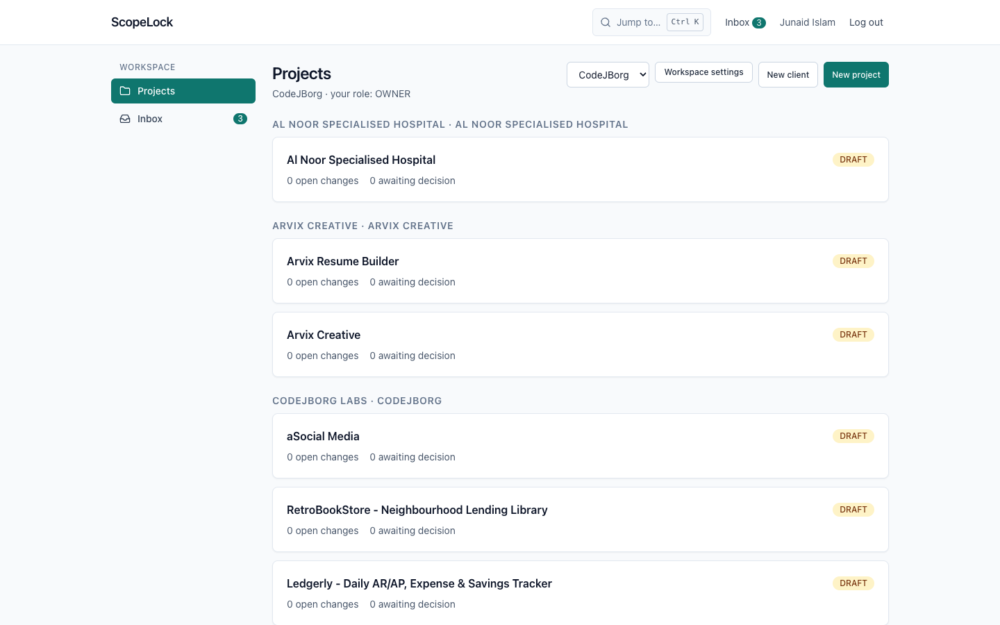
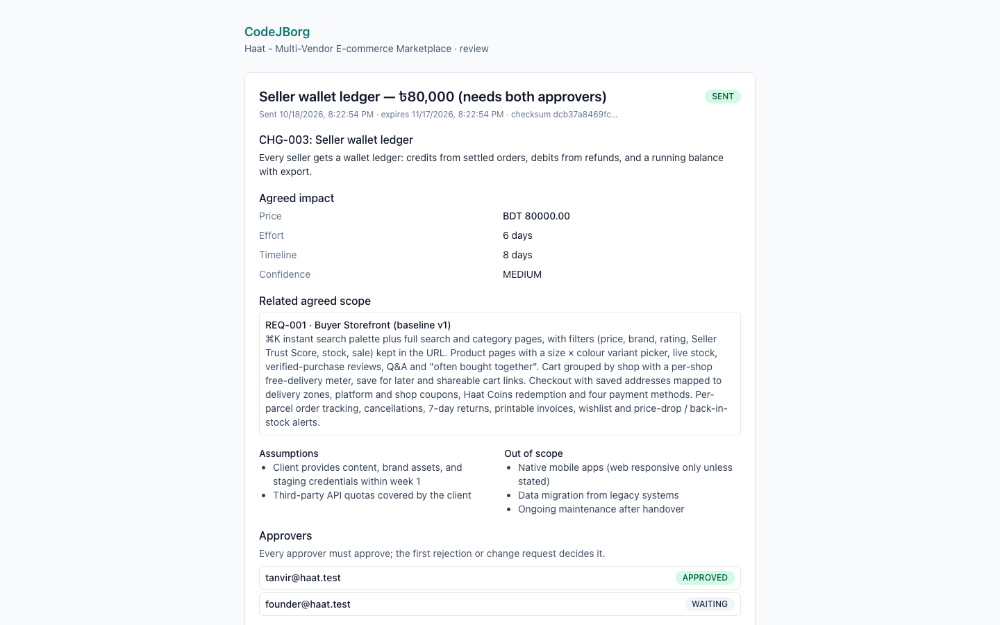
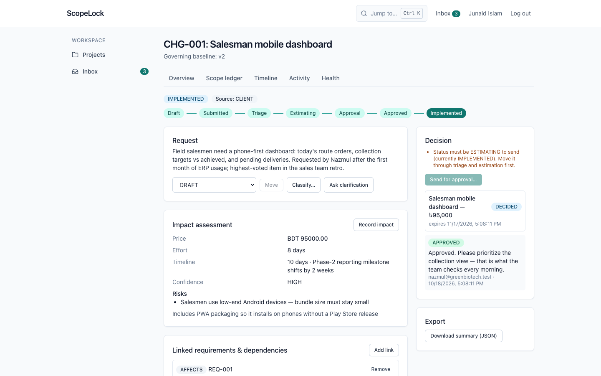

# ScopeLock

[](LICENSE)
[](LICENSE)

> Open-source shared system of record for client scope, change requests, approvals, and delivery evidence.

ScopeLock answers four questions without searching through email, chat, and meeting notes:

1. What did we agree to deliver? (**Scope Ledger** — versioned requirements)
2. What has changed since that agreement? (**Change requests + agreement diff**)
3. Who approved each change, and when? (**Client decision inbox + audit trail**)
4. What does the change do to price, effort, and delivery date? (**Impact preview**)

The full product and technical blueprint lives in
[plan/ScopeLock_Product_and_Technical_Development_Plan.md](plan/ScopeLock_Product_and_Technical_Development_Plan.md).
Operator runbooks (secrets, AI data flow, backups, retention, vulnerability
management) live in [docs/OPERATIONS.md](docs/OPERATIONS.md).

## Monorepo layout

```text
scopelock/
├── apps/
│   ├── web/                 # React 18 + Vite + Tailwind client
│   └── api/                 # Express API (the only authority for business ops)
├── packages/
│   ├── contracts/           # shared Zod schemas / typed API contracts
│   ├── domain/              # pure domain rules (transitions, diff, policy, money…)
│   └── config/              # shared ESLint / TS presets
├── prisma/
│   ├── schema.prisma        # PostgreSQL schema (Neon in production)
│   ├── migrations/          # committed, CI-validated migrations
│   └── seed.ts              # local demo seed
├── docs/                    # operations + pilot flow notes
└── .env.example             # every supported variable (no real secrets)
```

Within `apps/api/src`, code is organized by domain module (`auth`,
`organizations`, `projects`, `scope`, `changes`, `approvals`, `files`,
`notifications`, `activity`, `ai`, …). Each module owns its routes, request
schemas, services, policy checks, and tests.

## Prerequisites

- Node.js ≥ 22 and npm
- PostgreSQL 16+ for production-like runs (optional locally — see below)
- No provider accounts are needed for local development: storage, email,
  realtime, and AI all have local/log fallbacks.

## Quickstart (local, zero dependencies)

```bash
npm install            # also builds shared packages + generates the Prisma client
cp .env.example .env   # defaults work out of the box (file-backed storage)

# Terminal 1 — API on http://localhost:4000
npm run dev:api

# Terminal 2 — web app on http://localhost:5173
npm run dev:web
```

Open http://localhost:5173, register an account (this creates your workspace),
and follow the pilot loop: create a client → create a project → publish a
scope baseline → submit a change → assess impact → send for approval → decide
from the review link. After seeding the portfolio demo (below), the login page
offers one-click sign-in for the agency and every client approver.

## Setup & run (detailed)

### 1. Prerequisites

- **Node.js ≥ 22** (`node --version`) and **npm ≥ 10** (`npm --version`).
  The repo pins `engines: node >= 22` — older runtimes fail at install.
- **Git** for cloning.
- **PostgreSQL 16+** — only if you want a production-like run. Local
  development needs nothing else: storage, email, realtime, and AI all have
  local/log fallbacks (see [Environment variables](#environment-variables)).

```bash
git clone <your-fork-or-repo-url> scopelock
cd scopelock
node --version  # expect v22+
```

### 2. Install dependencies

```bash
npm install
```

This is an npm workspaces monorepo (`apps/*`, `packages/*`). The
`postinstall` hook builds `packages/domain` + `packages/contracts` and
generates the Prisma client, so no manual build step is needed.

### 3. Configure the environment

```bash
cp .env.example .env
```

`.env.example` documents every supported variable — the defaults run
out of the box with file-backed storage (`DATA_FILE=./data/scopelock.json`).
Only set what you need:

| Goal | Variables |
| --- | --- |
| Zero-dependency dev | nothing (defaults) |
| Postgres (local or Neon) | `DATABASE_URL` (direct host, not the pooler — see note below) |
| AI features | `GROQ_API_KEY` and/or `OPENAI_API_KEY` (empty = deterministic fallbacks; `AI_PROVIDER` picks the primary) |
| Real uploads/email/realtime | `R2_*`, `EMAIL_API_KEY` + `EMAIL_FROM`, `ABLY_API_KEY` |

> **Neon users:** use the **direct** connection string for local `DATABASE_URL`.
> The transaction-mode pooler drops the multi-statement transactions that
> scope publish and approval decisions rely on (same database, stable
> transactions). The portfolio seed switches to the direct host automatically
> when it detects `-pooler` in the URL.

### 4. Prepare the database (Postgres only — skip for file mode)

```bash
# Local Postgres:
createdb scopelock
DATABASE_URL=postgresql://localhost:5432/scopelock npx prisma migrate deploy --schema prisma/schema.prisma

# ...or point DATABASE_URL at your provider in .env, then simply:
npx prisma migrate deploy --schema prisma/schema.prisma
```

The API reads `.env` itself, so once `DATABASE_URL` is set there you can drop
the inline prefix. If you see `The table 'public.*' does not exist`, the
migrations were never applied — run the command above. Migration `0020`
enables the `vector` extension for decision-memory search, so the Postgres
server needs the pgvector module installed (`brew install pgvector`, the
`pgvector/pgvector` image, or your provider's extension toggle) —
see [docs/OPERATIONS.md](docs/OPERATIONS.md) for the lexical fallback.

### 5. Seed a demo workspace (optional, recommended)

```bash
npm run seed            # tiny Acme/Globex workspace (file or Postgres)
npm run seed:portfolio  # full 16-project CodeJBorg workspace (see below)
```

Both seeds are idempotent-ish: `seed` skips when its users exist,
`seed:portfolio` resumes and skips finished work. Seed-time emails/realtime
events are suppressed, so nothing leaks to real providers.

### 6. Run the app (two terminals)

```bash
# Terminal 1 — Express API with hot reload
npm run dev:api          # http://localhost:4000  (health: /healthz, /readyz)

# Terminal 2 — Vite web client with hot reload
npm run dev:web          # http://localhost:5173
```

Verify the API is up: `curl http://localhost:4000/healthz` → `200`.
Then open http://localhost:5173 and register, or use the demo logins.

### 7. Run the checks

```bash
npm run typecheck        # tsc --noEmit across every workspace
npm run lint             # ESLint, zero warnings allowed
npm run test             # domain unit tests + API integration suite
npm run test:contracts   # API envelope + pagination contract suite
npm run e2e              # Playwright suite (builds API first, uses :memory: store)
```

### Troubleshooting

| Symptom | Fix |
| --- | --- |
| `The table 'public.*' does not exist` | Run `npx prisma migrate deploy --schema prisma/schema.prisma` |
| `Transaction not found` / publish fails on Neon | Switch `DATABASE_URL` to the direct (non-pooler) host; restart `dev:api` |
| `Project limit reached for the FREE plan (3)` | Expected on fresh orgs — upgrade in org settings, or seed less |
| `EADDRINUSE` on `:4000` / `:5173` | Another server holds the port — stop it or set `PORT=` (API) |
| `401` on `/auth/me` before login | Normal — it just means "no session yet" |
| e2e suite talks to your real DB | Fixed in `playwright.config.ts` (`DATABASE_URL: ""` forces `:memory:`); pull latest |
| `engine Unsupported` at install | Upgrade Node to ≥ 22 (`nvm install 22` / volta / fnm) |

To load a demo workspace instead:

```bash
npm run seed           # uses DATA_FILE (or DATABASE_URL when set to postgres)
```

### Demo workspace (portfolio seed)

A richer alternative to `npm run seed`: builds a "CodeJBorg" workspace from a
real 16-project portfolio catalogue, driving the actual HTTP API end to end.

```bash
npm run seed:portfolio   # resumable; skips work a previous run already did
```

Log in at http://localhost:5173 (or use the one-click demo buttons on the login page):

- Agency: `demo@codejborg.studio` / `password1234`
- Clients (all / `password1234`): `nazmul@greenbiotech.test`,
  `tanvir@haat.test`, `sakib@quickfood.test`, `rahim@privateclient.test`,
  `sadia@healthops.test`

What's inside:

- **10 clients, 16 projects** — real names, overviews, tech stacks, live/repo
  links, BDT budgets. The 6 client projects keep their real client names
  (Green Biotech ×2, Arvix ×2, Al Noor, Nibash); the rest are grouped under
  realistic owners plus a CodeJBorg Labs client for internal products.
- **Published scope baselines on all 16** — 102 requirements total, each with
  acceptance criteria, assumptions, and exclusions.
- **Seven showcase lifecycles** covering every state:
  - Green Biotech ERP — change approved by the client → amended into scope v2
    (check the v1/v2 diff) → implemented, with delivery evidence and a
    decision note
  - Haat — change awaiting decision (review link is printed at the end of the
    seed run; also visible in the client inbox as `tanvir@haat.test`)
  - QuickFood — estimating, with an answered clarification round
  - Nibash — rejected with a reason
  - HealthOps — two changes bundled into one approval, approved in-app
  - InterEd — fresh request awaiting triage
  - Green Biotech (corporate site) — no-charge change approved and
    implemented (absorbed work in the contract ledger)

Suggested click path: log in as the agency → open Green Biotech ERP → scope
(v1 vs v2) → change CHG-001 (full audit trail) → activity. Then open the Haat
review link in an incognito window to see the client side.

Notes:

- Data lives in [prisma/portfolio-data.json](prisma/portfolio-data.json),
  script in [prisma/seed-portfolio.ts](prisma/seed-portfolio.ts). Seed-time
  outbox rows are marked delivered so no demo emails or realtime events leak
  to real providers.
- Against Neon/Postgres, use the **direct** (non-pooler) connection string for
  `DATABASE_URL` locally: the transaction-mode pooler drops the
  multi-statement transactions that publish/decide rely on. The seed script
  switches to the direct host automatically when it detects `-pooler` in the
  URL.

### Storage modes

| `DATABASE_URL` / `DATA_FILE` | Backend | Use |
| --- | --- | --- |
| `DATABASE_URL=postgres://…` | PostgreSQL via Prisma | production, CI postgres job |
| `DATA_FILE=./data/scopelock.json` (default) | JSON file store | local development |
| `DATA_FILE=:memory:` | in-memory store | tests, Playwright, throwaway runs |

File-backed and in-memory modes implement the same `Store` interface as
PostgreSQL, including transactions with rollback.

### Self-host in 5 minutes

The compose stack runs Postgres, the API, and the web client with healthchecks:

```bash
cp .env.example .env   # then set DB_PASSWORD plus the three URLs below
docker compose up --build -d
```

In `.env`, set `DB_PASSWORD` to a long random string and point all three URLs
at the compose web tier (same-origin: the web tier proxies `/api/*` to the API):

```dotenv
WEB_URL=http://localhost:8080
API_URL=http://localhost:8080
AUTH_URL=http://localhost:8080
```

Open http://localhost:8080 and register — the first account owns the workspace.
Going public needs a few more changes in `.env`:

- `NODE_ENV=production`
- `AUTH_SECRET=` — at least 32 random chars (`openssl rand -hex 32`)
- `WEB_URL=`, `API_URL=`, `AUTH_URL=` — your public `https://` origin (same
  value three times)
- Terminate TLS in front of the `web` service (reverse proxy or load
  balancer); the compose stack itself serves plain HTTP
- Optionally `R2_*`, `ABLY_API_KEY`, `EMAIL_API_KEY` + `EMAIL_FROM` for real
  uploads, realtime, and email

Production refuses to boot without a ≥32-char `AUTH_SECRET`, a `DATABASE_URL`,
and non-localhost `WEB_URL`/`API_URL`/`AUTH_URL`. Back up the `pgdata` and
`uploads` volumes together (see [docs/OPERATIONS.md](docs/OPERATIONS.md) §7);
upgrade with `git pull && docker compose up --build -d` (migrations run
automatically on API start).

Bare-metal production (no Docker) is the same idea without containers:

```bash
npm run build
DATABASE_URL=postgresql://localhost:5432/scopelock AUTH_SECRET=$(openssl rand -hex 32) \
  WEB_URL=https://app.example.com API_URL=https://app.example.com AUTH_URL=https://app.example.com \
  UPLOAD_DIR=/var/lib/scopelock/uploads NODE_ENV=production npm start
```

## Tour the app

- **Command palette** (`Ctrl/⌘+K` or the header search box) — jump to any
  project, page, or setting; contextual project links; `/?create=` shortcuts.
- **Project board** (project → Board tab) — change requests as a Kanban board
  with drag-and-drop and per-card Move controls (same transitions the API
  enforces).
- **Timeline** (project → Timeline) — baselines, submissions, review packages,
  and decisions in chronological order, with milestone strip and kind filters.
- **Inbox** — pending decisions plus project notifications in one place with
  mark-read; the header/sidebar badge always equals what the page shows.
- **Change page** — workflow stepper from draft to implemented, impact
  (manual or computed from org rate cards and estimate templates),
  clarifications, evidence, and exports.
- **Contract tab** (project → Contract) — derived contract value: baseline
  budget + approved change deltas = current value, plus pending exposure,
  absorbed (no-charge) work, and value by scope version. The dashboard shows
  the org rollup per currency (amounts are never converted).
- **Invoice-ready export** (Contract tab) — approved changes per period as
  CSV or JSON line items with per-currency totals, ready for the agency's
  own invoicing tool. ScopeLock does not invoice, tax, or collect payment.
- **Allowance tab** (project → Allowance) — pre-agreed hours/amount pools
  the client grants by decision; approved changes draw from them with client
  notification and an objection window. Off by default, always visible.
- **Review links** — login-free client decisions with immutable packages,
  selectable verdict cards, and per-approver vote tracking. Multi-approver
  packages stay open until the decision rule resolves; recorded votes are
  final and the checksum still binds every one of them.
- **Policy tab** (project → Policy, staff only) — amount thresholds that
  pick the decision rule per package (any approver decides, all must
  approve, or approvers vote in order), with an optional per-send override
  in every send dialog.
- **Proposal options** (change page) — 2–4 priced alternatives the client
  picks between on the review link. The pick becomes the change's
  effective impact; every approver must agree on the same one.
- **Parked** (board column + changes filter) — shelve work that is not
  ready and revive it into a new submission later.
- **Review step-up** (workspace settings → project Policy tab) — optional
  email code + typed-name confirmation on review links, recorded with each
  decision. An identity check, not an e-signature.
- **Change Order PDF + decision certificate** (review page, decided
  packages) — deterministic PDF with the package checksum and a QR/URL to
  a public verify page (`/verify/:approvalId`) that recomputes the
  checksum and shows match/mismatch from the package contents only.
- **Audit integrity** (project → Activity) — every audit event links to
  its predecessor by SHA-256. Recompute the chain in one click (or
  `npm run audit:verify -- --project <id>`) to prove history was not
  edited, deleted, or reordered.
- **Delivery acceptance** (scope → Request acceptance) — the client
  accepts delivered requirements over the same review links, with
  criteria and evidence snapshotted into the package. A configurable
  deemed window (Policy tab) accepts by policy at the deadline when
  nobody objects — recorded as policy, never as a client decision.
- **Escalation** (Policy tab) — stalled packages escalate exactly once
  past the project's delay: undecided approvers get a second nudge, or
  the agency leads are told the package is stalled. Off by default.
- **API keys + webhooks** (workspace settings) — scoped machine keys
  (shown once, hashed, rotatable) and HMAC-signed event deliveries with
  a delivery log and replay. The integration surface is specified at
  `GET /api/openapi.json`.
- **GitHub linking** (project → Integrations, staff opt-in) — connect a
  repository webhook; merged PRs and pushes are traced back to `CHG-###`
  / `REQ-###` mentions. Only identifiers are stored, and merged work
  with no approved link surfaces on the Health page. External events
  never change scope state.
- **Notification channels** (workspace settings) — approval events reach
  approvers and leads on Slack (shared org channel), SMS, and WhatsApp,
  all through the outbox. Per-user preferences with an E.164 phone;
  providers are a pluggable interface with log drivers locally.
- **Intake forms** (project → Intake, staff only) — revocable public links
  (embeddable via iframe) that accept requests without an account.
  Submissions land SUBMITTED with source `INTAKE_FORM`, flagged “unverified
  submitter”; honeypot + rate limits blunt bots.
- **Scope check** — before submitting (intake form or new-change dialog),
  an advisory check compares the words against the agreed baseline and
  shows likely-covered requirements with excerpts. Never blocks; in-app
  adds optional AI refinement.
- **Inbound email** (project → Intake) — unguessable per-project aliases;
  forwarded mail lands as unverified `INBOUND_EMAIL` changes with quoted
  history stripped and attachments scanned. Signed webhook + dev simulator.
- **Import from text** (project header) — paste a call transcript or email
  thread; AI proposes one draft change per implicit ask with source excerpts.
  A human accepts or edits each draft; nothing is created automatically.
- **Decision memory** (project → Activity → Search past decisions) — find
  decided approvals by words, with pgvector semantic ranking when Postgres
  and `OPENAI_API_KEY` are configured (lexical fallback otherwise).
  Results are filtered by your access before ranking and quote verbatim
  excerpts that link back to the original records — no generated conclusions.
- **Price suggestions + actuals** (change page, project → Actuals) —
  comparable approved changes with their real approved prices next to a new
  estimate (no black-box number), optional actual effort/cost once
  implemented, and an estimate-vs-actual report per project.
- **Scope templates + CSV import** (workspace settings, scope page) — an org
  library of starting templates with standard assumptions/exclusions that
  instantiate into a draft scope version, plus CSV requirement import with
  a dry-run preview and per-row errors (all rows or none).
- **Google/GitHub sign-in + passkeys** (login page, workspace settings →
  Security) — OAuth authorization-code + PKCE that links only to
  provider-verified matching emails (unknown identities never mint
  sessions), and WebAuthn passkeys with user verification. TOTP still
  gates MFA-enabled logins; the last sign-in method cannot be removed.
- **Bangla + per-user language** (header switcher) — the full UI in English
  or Bangla with Intl money/date/number formatting, persisted to your
  profile. Review links and decision certificates render in the
  project/org default language instead.
- Fully navigable on mobile (hamburger menu, responsive tables and dialogs).

### Screenshots

Captured from the portfolio demo seed (`npm run screenshots` regenerates them):





## Scripts

| Command | What it does |
| --- | --- |
| `npm run dev:api` / `npm run dev:web` | hot-reload API / web client |
| `npm run build` | packages → API → web production builds |
| `npm start` | run the built API in production (needs env, see self-host guide) |
| `npm run screenshots` | regenerate `docs/screenshots/*.png` from the portfolio seed |
| `npm run typecheck` | `tsc --noEmit` for every workspace (incl. API tests) |
| `npm run lint` | ESLint with zero-warning tolerance |
| `npm run test` | domain unit tests + full API integration suite |
| `npm run test:contracts` | API contract suite (envelopes + pagination) |
| `npm run e2e` | Playwright suite (pilot loop, palette, board, timeline, inbox, accessibility) |
| `npm run seed` | demo workspace seed |
| `npm run seed:portfolio` | full 16-project portfolio demo workspace |
| `npm run openapi [-- --check]` | regenerate (or freshness-check) the OpenAPI spec from Zod contracts |
| `npm run prisma:validate` | Prisma schema validation |
| `npm run audit:verify -- --project <id>` | recompute a project's audit hash chain outside the app |
| `node scripts/check-i18n.mjs` | CI check: every `t()` key exists in English, and `bn` matches keys + placeholders |
| `TEST_DATABASE_URL=… npx vitest run tests/prisma-smoke.test.ts` (in `apps/api`) | live-Postgres migration + store smoke test |
| `TEST_DATABASE_URL=… npx vitest run tests/audit-chain-prisma.test.ts` (in `apps/api`) | live-Postgres audit-chain concurrency + same-transaction append tests |

## Environment variables

See [.env.example](.env.example) for the complete list. Highlights:

- `AUTH_SECRET` — session/token signing (≥32 chars in production; random per
  process in dev/test when empty)
- `GROQ_API_KEY` / `GROQ_MODEL` (`openai/gpt-oss-120b`) and `OPENAI_API_KEY` /
  `OPENAI_MODEL` (`gpt-4o-mini`) — server-only AI providers; `AI_PROVIDER`
  picks the primary and the other serves as failover. Empty keys =
  deterministic fallbacks, manual workflow unaffected.
  `OPENAI_BASE_URL` optionally points both chat failover and
  decision-memory embeddings at an OpenAI-compatible endpoint
- `AI_ENABLED` — global kill switch; organizations and projects can also opt out
- `GOOGLE_CLIENT_ID`/`GOOGLE_CLIENT_SECRET`,
  `GITHUB_CLIENT_ID`/`GITHUB_CLIENT_SECRET` — OAuth login (authorization
  code + PKCE); leave a pair empty to disable that provider. Callback:
  `<API_URL>/api/v1/auth/oauth/<provider>/callback`
- `WEBAUTHN_RP_ID` (`localhost` for dev) / `WEBAUTHN_RP_NAME` — passkey
  relying party; the browser origin must equal `WEB_URL`
- `R2_*` — Cloudflare R2 object storage; unset = local signed-URL driver
- `ABLY_API_KEY` — realtime fan-out; unset = REST polling stays correct
- `EMAIL_API_KEY` + `EMAIL_FROM` (+ `EMAIL_HTTP_ENDPOINT`, Resend by
  default) — transactional email; unset key = log driver
- `INBOUND_EMAIL_DOMAIN` / `INBOUND_EMAIL_WEBHOOK_SECRET` — per-project
  inbound aliases and provider webhook verification
- `MALWARE_SCANNER_URL` — optional ClamAV-style webhook for uploads
- `PENDING_UPLOAD_TTL_HOURS` (24) / `DELETED_FILE_PURGE_DAYS` (30) — retention
- `API_KEY_RATE_LIMIT_PER_MIN` (300) — per-key quota for machine API keys
- `SMS_API_URL`/`SMS_API_KEY`, `WHATSAPP_API_URL`/`WHATSAPP_API_KEY` — optional SMS/WhatsApp providers (empty = log driver)
- `RATE_LIMIT_DISABLED=1`, `OUTBOX_AUTODRAIN=false` — test/CI conveniences

Never put secrets in `VITE_*` variables — the browser bundle must not contain
credentials (enforced by a security regression test).

## Architecture rules (enforced in code)

1. The Express API is the only authority for business operations and
   authorization. React never touches the database or provider credentials.
2. PostgreSQL owns business state; R2 holds bytes; Ably carries transient
   update events only.
3. Every protected action checks organization membership, project access, and
   the required role server-side (`http/access.ts` + `domain/policy.ts`).
4. Publish, decision, and send operations commit inside database transactions
   together with their audit and outbox entries.
5. AI output is untrusted draft data: it cannot publish scope, send approvals,
   or override deterministic policy. Invented requirement IDs are rejected.
6. External side effects (email, realtime) go through an outbox table with
   retried, idempotent delivery — a provider outage cannot corrupt a completed
   domain operation.

## Testing strategy

| Layer | Location | Focus |
| --- | --- | --- |
| Unit | `packages/domain/tests` | transitions, diff, checksum, health, money, policy |
| API integration | `apps/api/tests` | tenant scoping, atomic workflows, presigned-URL authz |
| Contract | `apps/api/tests/contract.test.ts` | error envelope + cursor pagination consistency |
| E2E | `apps/web/e2e/*.spec.ts` (31 specs) | register → baseline → change → approval → decision plus one spec per feature flow, each with axe scans |
| Security regression | `apps/api/tests/security.test.ts` | IDOR, token expiry/reuse, CSRF, secret leaks |
| AI evaluation | `apps/api/tests/ai.test.ts` | invented-ID rejection, fallback, injection resistance |
| Accessibility | `apps/web/e2e/a11y.spec.ts` | axe scans (serious/critical) on login + dashboard |
| Postgres smoke | `apps/api/tests/prisma-smoke.test.ts` | migrations apply; PrismaStore round-trips (CI + `TEST_DATABASE_URL`) |

CI runs typecheck, lint, unit + API tests, contract tests, the i18n
parity check, migration validation with drift detection against a fresh
Postgres, the Postgres store tests (smoke + audit-chain), a production
build, the full Playwright suite, and an advisory vulnerability scan.

## Security model

- Sessions: `HttpOnly`, `SameSite=Lax`, `Secure`-in-production cookies;
  logout and password change invalidate sessions; CSRF origin/referer checks
  on cookie-authenticated mutations (missing origin rejected in production).
- Passwords hashed with scrypt; TOTP multi-factor authentication with sealed
  secrets and single-use recovery codes (owners/admins should enable it).
- Uploads: type/size allowlists, per-plan quotas, SHA-256 integrity,
  EICAR + executable-magic heuristics, optional external scanner, quarantine
  on verdict; downloads via 15-minute signed URLs; private buckets only.
- Approval review links are high-entropy, expiring, revocable, bound to an
  immutable package checksum, rate-limited, and fully audited. Optional
  step-up (emailed OTP: hashed, expiring, attempt-limited, bound to token
  + approver) plus typed-name confirmation is recorded with the decision —
  an identity check, never legal e-signature.
- OAuth links only to provider-verified emails matching the signed-in user
  (or a prior link at login); passkeys use sealed challenge cookies and
  user verification. API keys are shown once, stored hashed, scoped,
  rotatable, and rate-limited; webhooks carry HMAC-SHA256 + timestamp
  signatures with SSRF-guarded HTTPS-only targets in production.
- Audit history is append-only; account deletion deactivates the login while
  preserving the audit trail (see `docs/OPERATIONS.md` for PII hard-delete).

## Metrics & health

- `GET /api/v1/projects/:id/health` — explained scope-health signals (aging
  requests, pending/expired approvals, unlinked work, unapproved
  implementation), never a black-box score.
- `GET /api/v1/projects/:id/metrics` — §17 product metrics incl. decision
  quality and AI suggestion acceptance.
- `GET /api/v1/organizations/:id/metrics` — weekly active projects.
- `/healthz` / `/readyz` — liveness and storage readiness probes.

## Open source & contributing

ScopeLock is free and open-source software under the [MIT License](LICENSE)
— use it for client work, host it yourself, fork it, and shape it to your
agency's process.

- **Contribute:** see [CONTRIBUTING.md](CONTRIBUTING.md) for the workflow,
  verification gates, and PR checklist. Changes are tracked in
  [CHANGELOG.md](CHANGELOG.md).
- **Report issues:** open a GitHub issue (bug/feature templates provided).
  For security vulnerabilities, report privately per
  [SECURITY.md](SECURITY.md) instead of filing a public issue — see
  [Security model](#security-model) for what is covered.

## License

MIT © CodeJBorg — see [LICENSE](LICENSE) for the full text.
